<a href="https://github.com/soctrungkien/scriptroblox"><picture><source media="(prefers-color-scheme: dark)" srcset="assets/project-scriptroblox-dark.svg"></picture></a>&nbsp;<a href="https://github.com/soctrungkien/hosts"><picture><source media="(prefers-color-scheme: dark)" srcset="assets/project-hosts-dark.svg"></picture></a>

<a href="https://github.com/soctrungkien/ZaliaBetter-Info"><picture><source media="(prefers-color-scheme: dark)" srcset="assets/project-zaliabetter-info-dark.svg"></picture></a>&nbsp;<a href="https://github.com/soctrungkien/1HzH9Axaj"><picture><source media="(prefers-color-scheme: dark)" srcset="assets/project-1hzh9axaj-dark.svg"></picture></a>

<picture><source media="(prefers-color-scheme: dark)" srcset="assets/stats-dark.svg"></picture>

<picture><source media="(prefers-color-scheme: dark)" srcset="assets/streak-dark.svg"></picture>

<picture><source media="(prefers-color-scheme: dark)" srcset="assets/wave-dark.svg"></picture>

<a href="https://soctrungkien.github.io/"><picture><source media="(prefers-color-scheme: dark)" srcset="assets/button-1-dark.svg"></picture></a>&nbsp;&nbsp;<a href="https://github.com/soctrungkien?tab=repositories"><picture><source media="(prefers-color-scheme: dark)" srcset="assets/button-2-dark.svg"></picture></a>

<a href="https://t.me/realknoname"><picture><source media="(prefers-color-scheme: dark)" srcset="assets/social-1-dark.svg"></picture></a>

<a href="https://metawka.github.io/expressive-profile/?from=soctrungkien"><picture><source media="(prefers-color-scheme: dark)" srcset="assets/credit-dark.svg"></picture></a>

